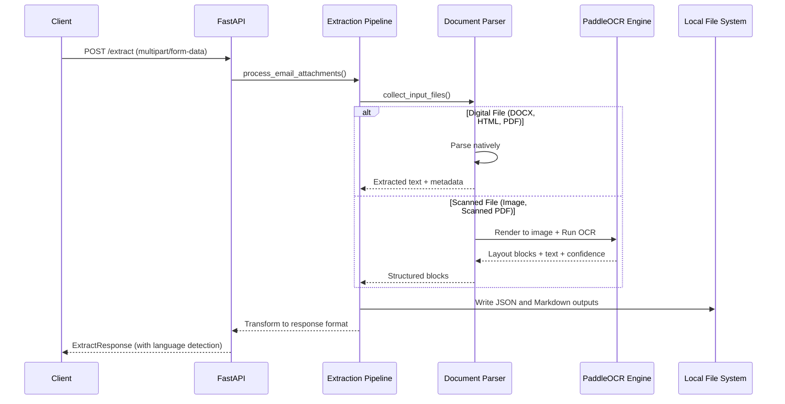
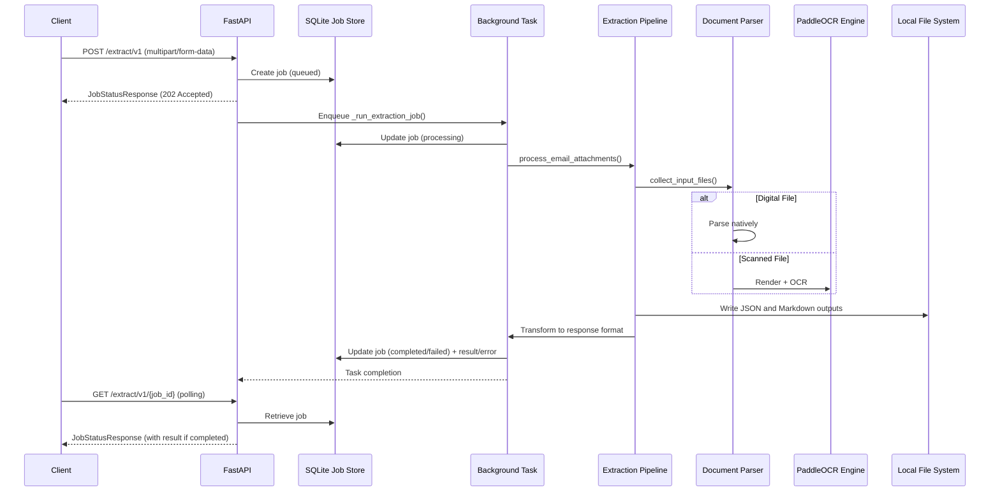
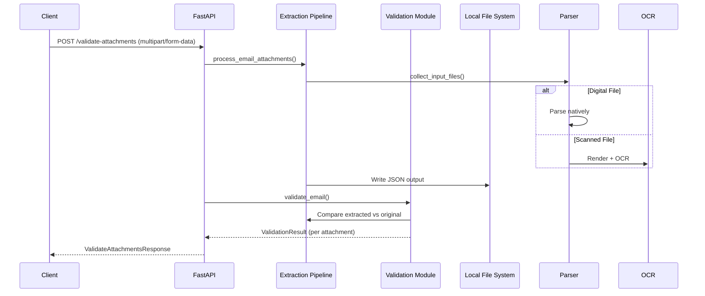

# Data Flow

## Synchronous Extraction Flow (`/extract`)



## Asynchronous Extraction Flow (`/extract/v1`)



## Validation Flow (`/validate-attachments`)



## Key Data Structures

### Extraction Record (Internal)
```json
{
  "email_id": "request_id",
  "attachments": [
    {
      "file": "filename.pdf",
      "format": "pdf",
      "pages": 5,
      "avg_confidence": 0.92,
      "is_password_required": false
    }
  ],
  "blocks": [
    {
      "type": "text",
      "content": "Extracted text...",
      "source_file": "filename.pdf",
      "page": 1,
      "order": 0,
      "bbox": [x1, y1, x2, y2],
      "score": 0.95
    }
  ]
}
```

### API Response (ExtractResponse)
```json
{
  "request_id": "req-123",
  "documents": {
    "filename.pdf": {
      "content": "Extracted text...",
      "avg_confidence": 0.92,
      "format": "pdf",
      "pages": 5,
      "language": "en"
    }
  }
}
```

### Job Store Record
```json
{
  "job_id": "uuid-string",
  "status": "queued|processing|completed|failed",
  "created_at": "ISO timestamp",
  "updated_at": "ISO timestamp",
  "result": { /* ExtractResponse */ },
  "error": "error message if failed",
  "progress": {
    "total": 5,
    "processed": 3
  }
}
```

## File System Layout

```
blob/
├── input/                 # Default input directory (configurable)
│   └── [user-provided files]
├── output/                # Default output directory
│   ├── jobs.db            # SQLite job store
│   └── jobs/              # Job-specific directories
│       ├── {job_id}/
│       │   ├── attachments/   # Uploaded copies (cleaned after processing)
│       │   └── output/        # Extraction results
│       │       ├── [filename].json
│       │       └── [filename].md
└── logs/                  # Application logs
    └── ingestion.log
```