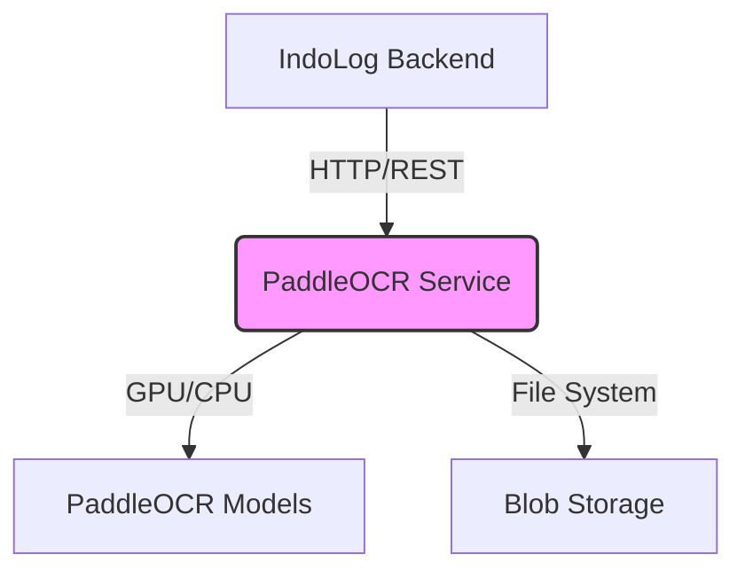
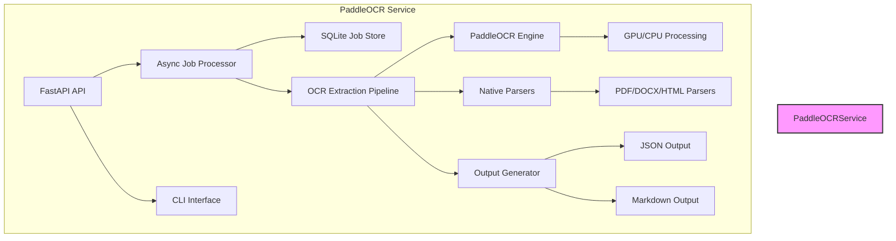
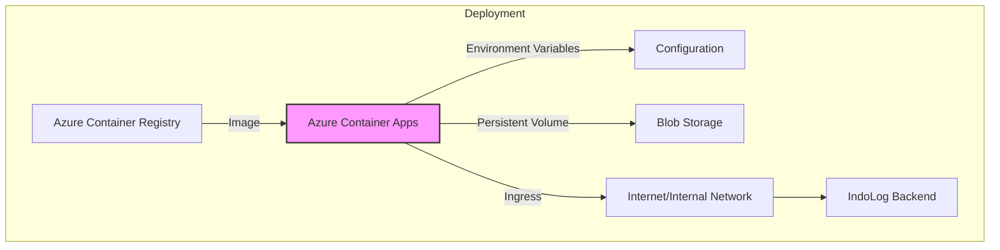

# Architecture Overview

## Context (C4 Level 1)

The PaddleOCR service is a backend microservice that provides OCR and document processing capabilities to the IndoLog platform.

## Containers (C4 Level 2)

Inside the PaddleOCR service, we have the following components:

## Components

### FastAPI API
- Exposes REST endpoints for document extraction, validation, and batch processing
- Handles file uploads, job creation, and result retrieval
- Provides synchronous and asynchronous (job-based) interfaces

### Async Job Processor
- Manages background extraction jobs using asyncio
- Uses a semaphore to limit concurrent GPU jobs
- Persists job status and results in SQLite
- Cleans up temporary files after processing

### SQLite Job Store
- Stores job metadata, status, and results
- Survives process restarts
- Simple TTL-based cleanup mechanism

### OCR Extraction Pipeline
- Orchestrates the document processing workflow
- Routes documents to appropriate parsers based on file type and content
- Applies OCR to scanned documents using PaddleOCR
- Extracts text from native digital documents using specialized parsers
- Generates structured output with metadata (confidence, language, format, etc.)

### PaddleOCR Engine
- GPU-accelerated layout analysis and text recognition
- Uses PP-StructureV3 model for document understanding
- Configurable via environment variables for performance/quality trade-offs

### Native Parsers
- Text extraction from digital PDFs (pdfplumber, PyMuPDF)
- Text extraction from DOCX (python-docx)
- Text extraction from HTML (BeautifulSoup4, lxml)

### Output Generator
- Creates structured JSON output with detected blocks (text, heading, table, image)
- Generates human-readable Markdown with inline citations
- Adds language detection (langdetect) where possible

## Deployment View

The service is deployed as a containerized application:

## Interaction Points

### API Endpoints
- `POST /extract` - Synchronous document extraction
- `POST /extract/v1` - Asynchronous job submission
- `GET /extract/v1/{job_id}` - Job status and result retrieval
- `POST /extract-dir` - Process files from server directory
- `POST /validate-attachments` - Validate extracted text against originals
- `POST /batch-extract` - Process multiple directories
- `GET /health` - Health check

### Configuration
- Environment variables loaded from `.env` file
- Runtime configuration via `config.py`
- OCR model behavior tuned via env vars

### Data Flow
1. Client sends document(s) via API or uses CLI
2. Service validates input and creates job record (if async)
3. Documents are routed to appropriate parser (native vs OCR)
4. OCR engine processes scanned documents; native parsers handle digital files
5. Results are aggregated, language detected, and formatted
6. Output stored as JSON and Markdown files
7. Job status updated; results available via API or file system